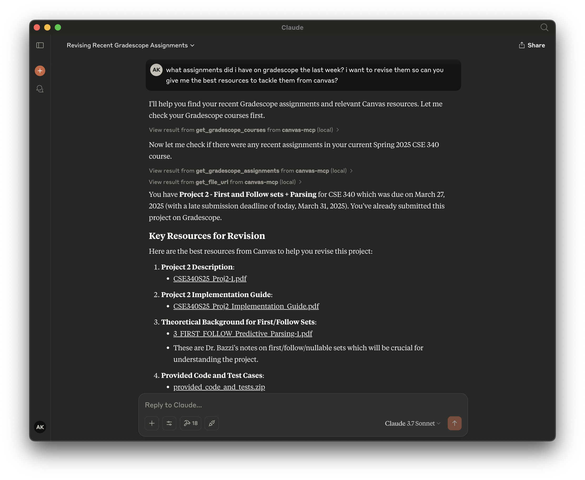
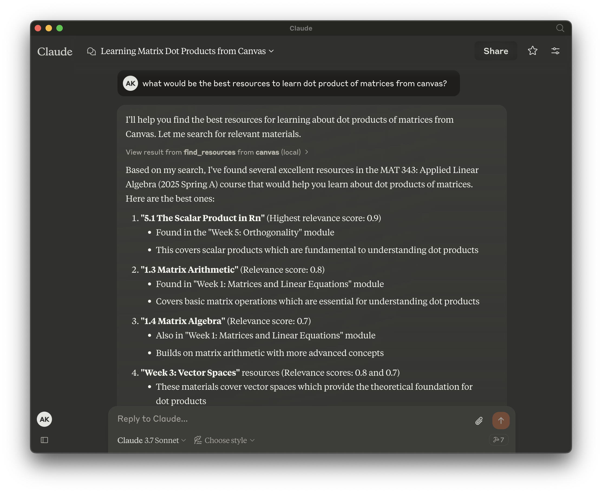

# Canvas MCP

Canvas MCP is a set of tools that allows your AI agents to interact with Canvas LMS and Gradescope.





## Features

- **Find relevant resources** - Ability to find relevant resources for a given query in natural language!
- **Query upcoming assignments** - Not only fetch upcoming assignments, but also provide its breakdown for a given course.
- **Get courses and assignments from Gradescope** - Query your Gradescope courses and assignments with natural language, get submission status, and more!
- Get courses
- Get modules
- Get module items
- Get file url
- Get calendar events
- Get assignments
- and so much more... 

## Setup

Note down the following beforehand:
1. Canvas API Key from `Canvas > Account > Settings > Approved Integrations > New Access Token`
2. Gradescope Email and Password https://www.gradescope.com/ (optional - only needed for Gradescope tools)

### Run the server locally

```bash
git clone https://github.com/aryankeluskar/canvas-mcp.git
cd canvas-mcp
npm install
cp .dev.vars.example .dev.vars
# edit .dev.vars and add your Canvas API key (and Gradescope credentials, if wanted)
npm start
```

The MCP server is now available at `http://localhost:8787/mcp` (Streamable HTTP transport). A health check is available at `http://localhost:8787/health`.

`.dev.vars` is gitignored - it holds your real credentials and must never be committed.

### Register with Claude Code

```bash
claude mcp add --transport http canvas http://localhost:8787/mcp
```

Verify with `claude mcp list`.

### Register with OpenCode

```bash
opencode mcp add canvas --url http://localhost:8787/mcp --global
```

### Register with other MCP clients

Any MCP client that supports the Streamable HTTP transport can use `http://localhost:8787/mcp` directly. Per-session configuration can also be passed via headers (`X-Canvas-Api-Key`, `X-Canvas-Base-Url`, `X-Gradescope-Email`, `X-Gradescope-Password`) instead of `.dev.vars`.

## Historical note

This server was previously distributed through [Smithery](https://smithery.ai), which shut down its MCP proxy, registry, and related services on October 31, 2026. The Smithery-specific `?config=` query parameter is no longer supported; use the direct local setup described above instead.

---

Built by [Aryan Keluskar](https://aryankeluskar.com) :)
